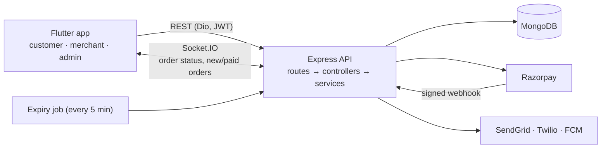

# Green Basket

A marketplace for fresh, local produce. Home growers and farmers sell
directly to nearby customers, and an admin team runs the platform. One
Flutter app serves all three roles, backed by a Node.js / Express / MongoDB
API with real-time updates.

| Customers | Merchants (farmers) | Admins |
|---|---|---|
| Browse, search and filter produce | Sign up and get verified | Approve or reject merchants |
| Add a recipe's ingredients to the cart in one tap | Manage products, stock and CSV bulk uploads | Manage users, categories, recipes and offers |
| Choose pickup or home delivery, with prices from the store's delivery zones | Accept and progress orders (pickup or delivery flow) | Cancel orders and issue refunds |
| Pay by cash, Razorpay (cards/UPI) or in-app wallet | Set delivery zones and the store location | Resolve disputes and returns |
| Track orders live, cancel, review, raise returns | Create coupons and offers | Generate merchant payouts, set commission |
| Earn loyalty points and redeem them as coupons | Sales, product and review analytics | Send mass notifications |

## Tech stack

- **App:** Flutter (Dart 3.10), GetX for state/routing/DI, Dio, Socket.IO client, Razorpay SDK, Firebase Messaging, Geolocator/Geocoding
- **API:** Node.js 18+, Express 4, MongoDB with Mongoose 8, Socket.IO, JWT auth (access + refresh tokens)
- **Integrations:** Razorpay (orders, verification, webhook, refunds), Cloudinary (images), SendGrid (email), Twilio (SMS), Firebase Cloud Messaging (push)
- **Testing:** Jest + Supertest against a real in-memory MongoDB, Flutter test

## Architecture



About 21k lines of backend JavaScript (24 models, 26 controllers) and 41k
lines of Dart (79 screens).

## Engineering highlights

The parts that needed the most care, and the tests that cover them:

- **No overselling, ever.** Checkout first prices and validates the whole
  order without writing anything. It then reserves stock with conditional
  atomic updates (`stock >= quantity`), then the coupon, then wallet money.
  If any step fails, everything reserved so far is released. A test fires
  five concurrent orders at the last unit: exactly one succeeds.
  ([`orderController.js`](backend/src/controllers/orderController.js), [`utils/stock.js`](backend/src/utils/stock.js))
- **One price everywhere.** A single pricing service (items + preparation
  surcharges, delivery-zone charge, coupon) powers both the checkout quote
  and order creation, so the total the app shows is exactly what is
  charged. ([`services/orderPricing.js`](backend/src/services/orderPricing.js))
- **Payments confirmed exactly once.** `/verify` and the Razorpay webhook
  race to confirm an online order, and an atomic conditional update makes
  sure only one wins. A payment that arrives for an expired or cancelled
  order is refunded automatically. Unpaid orders expire after 30 minutes and
  release their stock, after first checking with Razorpay that they weren't
  paid. ([`services/orderLifecycle.js`](backend/src/services/orderLifecycle.js))
- **Wallet integrity.** Every balance change is a single conditional
  aggregation-pipeline update that also records the exact balance
  before and after. Concurrent credits and debits can't overwrite each other,
  and a top-up is credited at most once per payment, for the amount Razorpay
  reports. ([`utils/walletHelpers.js`](backend/src/utils/walletHelpers.js))
- **Order status rules shared by the app and the API.** Pickup and delivery
  follow different flows, and only allowed transitions are accepted.
  Cancelling restocks, releases the coupon, reverses loyalty points and
  refunds to the original payment method. The Dart copy of the rules is
  checked against the backend by a test.
  ([`utils/orderStatus.js`](backend/src/utils/orderStatus.js), [`order_status.dart`](flutter_app/lib/utils/order_status.dart))
- **The app and API can't drift apart.** `npm run check:api` checks every
  HTTP call in the Flutter code against the routes the backend actually
  serves, and that every body/query key the app sends is one the handler
  actually reads (so a renamed field fails the build instead of failing
  quietly on a phone). Both checks also run inside `npm run test:run`. An
  integration test drives the app's real repositories against a seeded
  backend.

## Repository layout

```
backend/       Express API: src/{routes,controllers,services,models,utils,sockets}, tests/, scripts/
flutter_app/   Flutter app: lib/{modules/{auth,customer,merchant,admin},data,config,widgets,utils}, test/
docs/          Project overview, bug-fix log, Flutter API docs, nearby-seller spec
design/        HTML admin mock-ups and the app design file (Pencil)
```

## Running it locally

**Backend** (needs Node 18+ and a MongoDB connection string):

```bash
cd backend
npm install
cp .env.example .env    # set MONGODB_URI, JWT secrets, Razorpay KEY_ID/KEY_SECRET, …
npm run seed            # optional sample data
npm run dev             # http://localhost:5002/api
```

**App** (Flutter 3.38):

```bash
cd flutter_app
flutter pub get
flutter run --dart-define=API_URL=http://10.0.2.2:5002/api   # Android emulator
```

See [`flutter_app/README.md`](flutter_app/README.md) for iOS simulator and device addresses.

## Tests

```bash
cd backend && npm run test:run     # 357 tests, real in-memory MongoDB
cd backend && npm run check:api    # every app call matches a backend route, and every key it sends is read
cd flutter_app && flutter test     # status rules, token-refresh logic (+ integration test, see below)
```

The Flutter ↔ backend integration test (`flutter_app/test/api_integration_test.dart`)
runs against a seeded local backend. The steps are in
[`flutter_app/README.md`](flutter_app/README.md#tests).

## Known limitations

Honest list of what is not built yet, so nothing in the app pretends otherwise:

- **Photo upload** is not implemented in the app (product, recipe and profile photos). The backend already accepts product images (`multipart`, field `images`); the app screens say "coming soon" instead of faking it.
- **Scheduled notifications** are not implemented; "Send now" works.
- **Tapping a push notification** does not navigate to the related screen yet.
- **Android push** needs `google-services.json` (see `flutter_app/README.md`); iOS is configured.
- **Exchanges**: the app raises returns (refund to wallet); the backend also models exchanges, which the app does not offer yet.

## Documentation

- [`docs/PROJECT_OVERVIEW.md`](docs/PROJECT_OVERVIEW.md): how the system fits together
- [`docs/BUG_FIX_GUIDE.md`](docs/BUG_FIX_GUIDE.md): issues found in a full code review and how each was fixed and tested
- [`backend/README.md`](backend/README.md): API endpoints, environment variables
- [`backend/docs/`](backend/docs): detailed API and feature documentation
